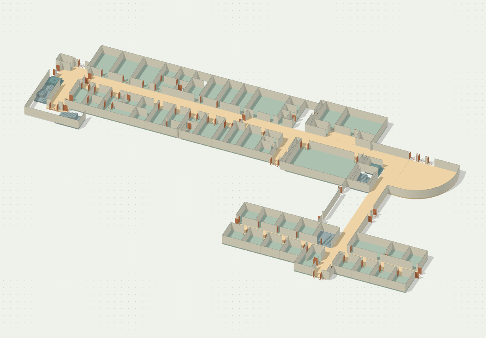

# 工程五館 1F｜Three.js 單樓層地圖 · Engineering Building 5, First-Floor Map

以地圖組的 [floor-1.svg](floor-1.svg) 建立工程五館一樓模型。桌面瀏覽器與 Android WebView 共用同一份檢視器，可離線瀏覽、水平旋轉 360°、縮放、切換俯視，以及按房號定位。檢視器支援圖層開關與原始圖面對照，桌面版也可匯出 GLB。

The model of the first floor of Engineering Building 5 is based on the mapping team's [floor-1.svg](floor-1.svg). The same viewer runs offline in desktop browsers and Android WebView. It supports 360° horizontal rotation, zoom, a top-down view, and room lookup by number. You can toggle layers and compare the model with the source drawing. The desktop viewer also exports GLB.



## 開啟地圖 · Open the Map

- **桌面瀏覽器**：直接開啟 [floor-1.html](floor-1.html)。使用支援 WebGL 2 的瀏覽器。拖曳旋轉、右鍵拖曳平移、滾輪縮放。
- **Android**：安裝建置產生的 `android/app/build/outputs/apk/debug/app-debug.apk`，開啟「工程五館樓層地圖」。單指拖曳旋轉，雙指平移或縮放。點「俯視」切換到平面視角，點「原始圖面」查看 SVG。
- **模型檔**：[floor-1.glb](floor-1.glb) 可直接匯入支援 glTF 的工具。

- **Desktop browser** — Open [floor-1.html](floor-1.html) directly in a browser that supports WebGL 2. Drag to rotate, right-drag to pan, and scroll to zoom.
- **Android** — Install the generated `android/app/build/outputs/apk/debug/app-debug.apk` and open the app labeled 「工程五館樓層地圖」 (Engineering Building 5 Floor Map). Drag with one finger to rotate. Use two fingers to pan or zoom. Tap 「俯視」 (Top View) for a plan view or 「原始圖面」 (Source Drawing) to see the SVG.
- **Model file** — Import [floor-1.glb](floor-1.glb) into any tool that supports glTF.

## 從原始碼建置 · Build from Source

在專案根目錄執行以下指令。建議使用 Node.js 22 以上版本。

Run the following commands from the project root. Node.js 22 or later is recommended.

```powershell
npm ci
npm run build
```

建置會將 Three.js、檢視器及 SVG 打包成根目錄的 `floor-1.html`。重新建置 Android App 前，先執行以上指令以更新 APK 內的地圖。

The build bundles Three.js, the viewer, and the SVG into `floor-1.html` at the project root. Run the commands above before rebuilding the Android app to include the updated map in the APK.

Android 建置使用 Android SDK 37 與 Gradle Wrapper，可使用 Android Studio 內建的 JDK。用 Android Studio 開啟 `android/` 後執行 App，或設定 `JAVA_HOME` 和 `ANDROID_HOME` 後，在 Windows 專案根目錄執行：

The Android build uses Android SDK 37 and the Gradle Wrapper. You can use the JDK bundled with Android Studio. Open `android/` in Android Studio and run the app, or set `JAVA_HOME` and `ANDROID_HOME` and run the following command from the project root on Windows.

```powershell
.\android\gradlew.bat -p android assembleDebug
```

App 的最低版本設定為 Android 8.0（API 26），裝置的 Android System WebView 仍須支援 WebGL 2。實際驗收環境見下方。

The minimum Android version is Android 8.0 (API 26). The device's Android System WebView must support WebGL 2. See the acceptance section below for the tested environment.

## `renderMap()` 整合介面 · Integration API

檢視器頁面提供 `window.renderMap(svgText, floor, options)`。頁面載入後，Android 的 `MapActivity` 透過 `evaluateJavascript()` 呼叫此函式，並從回傳值取得成功或錯誤狀態。Three.js 場景留在 WebView 內使用。

The viewer exposes `window.renderMap(svgText, floor, options)`. After the page loads, Android's `MapActivity` calls this function via `evaluateJavascript()` and reads the result to determine whether rendering succeeded. The Three.js scene stays inside the WebView.

```js
// 顯示內建的工程五館 1F
// Show the bundled first-floor map of Engineering Building 5.
window.renderMap();

// 以俯視模式顯示同一樓層
// Show the same floor in top-down view.
window.renderMap(undefined, undefined, { view_mode: '2d' });
```

| 參數 | 說明 |
| --- | --- |
| `svgText` | SVG 原始文字。省略時使用內建的 `floor-1.svg`。 |
| `floor` | 樓層資料包含 `building_id`、`map_version`、`floor`、`svg`。前三項須符合 SVG 的識別屬性。已校準資料須提供 `elevation_m` 與 `svg_transform`，其中包含 `origin_x_m`、`origin_z_m`、`scale_m_per_svg_unit`、`rotation_deg`。 |
| `options` | `view_mode` 可用 `'3d'` 或 `'2d'`。重新呼叫同一張圖時，`fit_to_view: false` 可在檢視模式相同的情況下保留視角。 |

| Parameter | Description |
| --- | --- |
| `svgText` | Raw SVG text. Defaults to the bundled `floor-1.svg`. |
| `floor` | Floor metadata contains `building_id`, `map_version`, `floor`, and `svg`. The first three fields must match the SVG's identifying attributes. Calibrated data must provide `elevation_m` and an `svg_transform` containing `origin_x_m`, `origin_z_m`, `scale_m_per_svg_unit`, and `rotation_deg`. |
| `options` | Set `view_mode` to `'3d'` or `'2d'`. Use `fit_to_view: false` to keep the current camera view when rendering the same map in the same mode again. |

回傳包含 `status`、`building_id`、`map_version` 與 `floor`。成功時附上 `scene`，失敗時附上 `error.code` 與 `error.message`。建物、樓層或地圖版本不符時回傳 `MAP_MISMATCH`。

The result contains `status`, `building_id`, `map_version`, and `floor`. A successful result includes `scene`. A failed result includes `error.code` and `error.message`. A building, floor, or map version mismatch returns `MAP_MISMATCH`.

## 圖面與座標 · Drawing and Coordinates

內建 1F 草稿沿用 SVG `viewBox` 的圖面單位。SVG 的水平與垂直方向分別對應 Three.js 的 X 與 Z 軸，Y 軸為高度。圖面尚未實測，牆高、門高與樓梯高度皆為示意。公尺座標需以地圖組提供的樓層轉換資料為準。

The bundled first-floor draft uses the drawing units of the SVG `viewBox`. The SVG's horizontal and vertical axes map to Three.js X and Z, respectively, while Y represents height. Field measurements are pending, so wall, door, and stair heights are illustrative. Use the mapping team's floor transform data for coordinates in metres.

牆體由 `walls` 圖層的封閉輪廓拉高，保留原有門洞。`doors` 提供門扇與開門方向，`rooms` 和 `corridors` 提供地板範圍，`stairs` 和 `elevators` 提供設施位置。`fixtures` 與 `labels` 作為圖面參考，`nav-anchors` 保存導航錨點。

Closed outlines in the `walls` layer are extruded to form walls while preserving existing door openings. The `doors` layer defines door leaves and swing directions. The `rooms` and `corridors` layers define floor areas, and `stairs` and `elevators` locate those features. The `fixtures` and `labels` layers provide drawing references. The `nav-anchors` layer stores navigation anchors.

## 驗收與進度 · Acceptance Testing and Progress

2026 年 11 月 26 日，以 Android 17（API 37）模擬器和 Android System WebView 145.0.7632.218 通過 11/29 單樓層驗收。

The single-floor map passed acceptance testing for the November 29 milestone on November 26, 2026, using an Android 17 (API 37) emulator with Android System WebView 145.0.7632.218.

- 原生 UI 呼叫 `renderMap()` 後成功顯示 1F，重複呼叫後仍只有一個畫布。
- 兩次 Android 單指滑動測試的累計水平旋轉角度為 364.16° 和 388.48°。
- 俯視幾何比對涵蓋 204 段牆、59 個空間、8 個走廊區塊、84 組門、4 個樓梯區和 2 個電梯區，全部通過。

- The native UI displayed the first floor after calling `renderMap()`. Repeated calls still produced a single canvas.
- The two single-finger swipe tests on Android produced cumulative horizontal rotations of 364.16° and 388.48°.
- The top-down geometry check passed for all 204 wall segments, 59 spaces, 8 corridor sections, 84 door groups, 4 stair areas, and 2 elevator areas.

在模擬器或測試裝置開啟 debug App，再從專案根目錄重跑驗收。若 `adb` 已加入 PATH，可省略最後的路徑參數。

Open the debug app on an emulator or test device, then rerun the acceptance checks from the project root. The final argument is optional if `adb` is on PATH. Replace the two placeholders below with the device serial and the ADB executable path.

```powershell
node android/verify-webview.mjs <裝置序號> <adb執行檔路徑>
```

[立體截圖](android/acceptance/android-3d.png) · [俯視截圖](android/acceptance/android-top.png) · [原圖截圖](android/acceptance/android-svg.png) · [完整驗收紀錄](3d-team.md#4-1129-單樓層驗收紀錄)

[3D screenshot](android/acceptance/android-3d.png) · [Top-down screenshot](android/acceptance/android-top.png) · [Source drawing screenshot](android/acceptance/android-svg.png) · [Full acceptance record](3d-team.md#4-1129-單樓層驗收紀錄)

12/04 里程碑規劃交付 `renderRoute()` 路線疊加與多樓層切換。 [3D 組開發進度表](3d-team.md)

The December 4 milestone is scheduled to deliver route overlays through `renderRoute()` and floor switching. [3D team development schedule](3d-team.md)

## 主要檔案 · Key Files

| 路徑 | 用途 |
| --- | --- |
| [src/model.js](src/model.js) | 從 SVG 圖層建立地板、牆體、門扇與設施幾何。 |
| [src/viewer.js](src/viewer.js) | `renderMap()`、視角控制、圖層切換與 GLB 匯出。 |
| [build.mjs](build.mjs) | 將模型檢視器與圖面打包成可離線開啟的 HTML。 |
| [MapActivity.java](android/app/src/main/java/tw/eng5/floormap/MapActivity.java) | Android 原生入口與 WebView 呼叫。 |
| [android/verify-webview.mjs](android/verify-webview.mjs) | 裝置觸控、圖面比對與截圖驗收。 |

| Path | Purpose |
| --- | --- |
| [src/model.js](src/model.js) | Builds floor, wall, door leaf, and facility geometry from SVG layers. |
| [src/viewer.js](src/viewer.js) | Implements `renderMap()`, camera controls, layer toggles, and GLB export. |
| [build.mjs](build.mjs) | Bundles the viewer and drawing into an HTML file that runs offline. |
| [MapActivity.java](android/app/src/main/java/tw/eng5/floormap/MapActivity.java) | Provides the native Android entry point and calls the WebView renderer. |
| [android/verify-webview.mjs](android/verify-webview.mjs) | Tests device touch input, compares geometry with the source drawing, and captures acceptance screenshots. |
