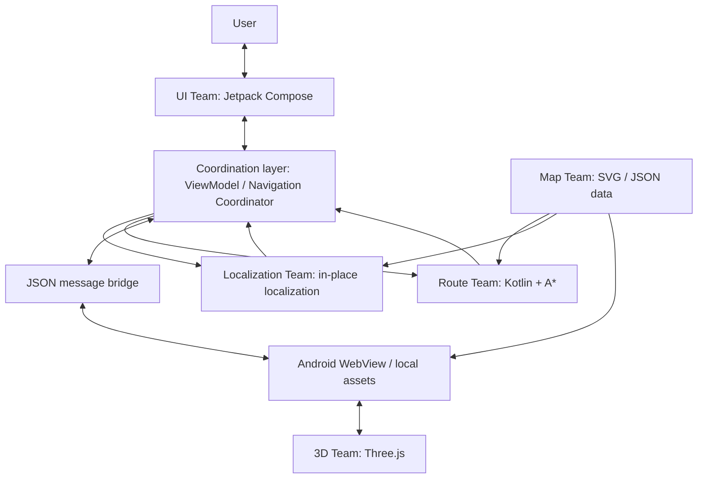
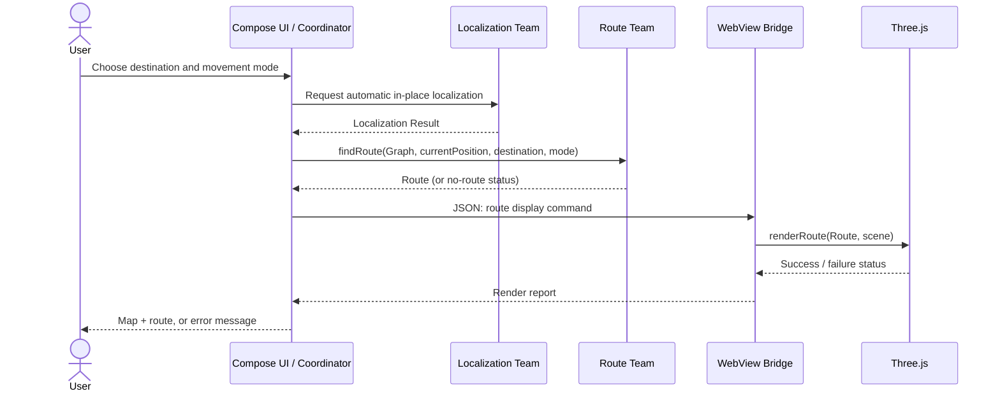

# Campus Indoor Navigation System V1 — Software System Architecture

> **File:** `docs/architecture/System_Architecture.en.md`  
> **Document version:** V1.0 (architecture decision baseline; programming interface details pending verification)  
> **Updated:** 2026-11-19  
> **Audience:** Map Team, Localization Team, Route Team, 3D Team, UI Team, and the integration lead  
> **Note:** This is an English translation of the Chinese original (`docs/architecture/System_Architecture.md`). If the two differ, the Chinese original prevails.

## 1. System Goals and Decisions

This system is an **indoor navigation Android app for a single campus building**. The V1 deliverable is an APK for team members and instructors to install and test. It does not need to be published on Google Play, does not require a backend server, and map and 3D assets must ship inside the APK. The core navigation flow runs **offline-first**.

| Item | V1 decision |
|---|---|
| Client | Android Native App |
| UI | Kotlin + Jetpack Compose |
| Module coordination | ViewModel / Navigation Coordinator (logical role) |
| Localization | Kotlin + native Android sensor / Wi-Fi APIs; **automatic in-place localization** |
| Routing | Kotlin + A*; handles same-floor / cross-floor routes and movement modes |
| Map | Map Team delivers local data: SVG, Graph, Node Mapping, Floor, Destination |
| 3D | JavaScript + Three.js; SVG → 3D geometry and route display |
| 3D hosting | Android WebView loading Three.js static assets bundled in the APK |
| Native/web communication | JSON message bridge (AndroidX WebKit is the candidate implementation) |
| Target deployment | Debug or test APK, installed directly; no Play Store |
| Backend / cloud | Not needed in V1; live network access must not be a prerequisite for core navigation |

**Scope:** V1 only requires the system to obtain a localization result automatically while the user is standing still. It does not require continuous localization while walking, drift correction, or automatic re-planning. The architecture should allow future extension, but extensions must not be treated as V1 acceptance prerequisites.

## 2. Logical Architecture and Responsibilities



### 2.1 Responsibility Boundaries of the Five Teams

| Team | Must be responsible for | Not responsible for |
|---|---|---|
| Map Team | Standard SVG, Graph, node mapping, Floor, Destination; offline `evaluateMapError` and error reports | 3D engine, localization, route computation, app UI |
| Localization Team | Automatically estimating in-place position without the user manually choosing a start point; outputting the standard Localization Result | Walking tracking and PDR drift correction (not V1), 3D rendering |
| Route Team | `findRoute`: matching the localized coordinate to a walkable node, resolving destination IDs, A*, movement modes and cross-floor routing, standard Route | Sensor acquisition, map drawing, user pages |
| 3D Team | `renderMap`, `renderRoute`: reading standard SVG / Route and visualizing them in Three.js | The A* algorithm, raw SVG map surveying, Android screen navigation |
| UI Team | User selection of destination / mode, invoking the coordination flow, showing the 3D container, presenting error messages | Internal localization algorithms, routing algorithms, Three.js 3D geometry implementation |

The **coordination layer (app layer)** manages call ordering across team modules and UI state. It is not an extra sixth team and not a backend service. The integration lead decides its module ownership and maintenance.

## 3. Shared Data Contracts and Coordinates

The single source of truth for cross-team data is `docs/interfaces/schemas/Data_Specification.md`; for cross-team functions it is `docs/interfaces/functions/function.md`. This document does not redefine existing fields, to avoid conflicting specifications.

**Eight shared specifications:** (1) SVG, (2) unified coordinates, (3) Graph, (4) Route, (5) Node Mapping, (6) Localization Result, (7) Floor, (8) Destination.

- Building local coordinates use **X, Z horizontal; Y up**, with distances in meters.
- The app's localization and routing mainly use `x`, `z`, `floor`; Three.js converts to `y` using the Floor's `elevation_m`.
- SVG drawing coordinates `(u,v)` are converted to `(x,z)` using the scale, rotation, and offset provided by Floor.
- The Map Team must ensure that SVG, Graph, Node Mapping, Floor, and Destination use compatible `map_version`, `building_id`, and coordinate system.
- No team may define new movement modes, floor representations, or destination ID semantics on its own.
- SVG drawing conventions **remain the existing conventions**; no separate SVG modeling contract is added now, and the Map Team is not required to build 3D models directly.

## 4. V1 Runtime Data Flow

### 4.1 Startup and Map Loading

1. The Android app starts and loads the map data and Three.js static assets packaged in the APK.
2. The app verifies that the data version / floor identifiers match (the detailed automatic verification flow will be defined in the test specification).
3. A WebView is created inside the Compose screen; the WebView loads the local Three.js page.
4. The app or WebView hands SVG, Floor, and display settings to `renderMap` using the agreed data exchange method.
5. Three.js reports the map initialization status, and the UI shows the map or an error message.

### 4.2 One-shot Navigation Flow



The Route Team is responsible for position matching, valid Edges, and mode restrictions; the UI does not compute routes itself. The 3D Team renders from the standard Route and does not modify node order or route cost.

### 4.3 Errors and Inability to Navigate

- Localization failure, insufficient localization confidence, invalid destination, no reachable route, missing map, and rendering failure must each be distinguishable and reported by the UI.
- The UI must not substitute fake coordinates or fake routes for a failed result.
- Concrete Exception types, error codes, and retry strategies are left to a later unified exception specification; teams must not invent mutually incompatible cross-team error interfaces in the meantime.

## 5. Android and Three.js Bridge

### 5.1 Chosen Direction

- Use a **WebView** to load HTML, JavaScript, CSS, and the Three.js bundle inside the APK.
- Compose embeds the WebView via `AndroidView` (the concrete wrapping is decided during UI / 3D integration).
- Kotlin and JavaScript interact through **JSON messages**, avoiding direct dependence on each other's internal classes.
- **Candidate bridge API:** `WebViewCompat.addWebMessageListener` / the corresponding WebMessage API; the concrete two-way reply design should be decided at the first integration.
- For local resources, `WebViewAssetLoader` mapped to a controlled HTTPS virtual domain is recommended, instead of opening native file permissions broadly through `file://`.

### 5.2 Design Constraints for the Message Contract

This only states design principles and **adds no new formal Function fields**. When `docs/interfaces/functions/function.md` is finalized, it should specify the bridge message `type`, request identifier, `payload`, reply, and error format.

| Direction | Scenario | Data source / purpose |
|---|---|---|
| Kotlin → JS | Load / update map | SVG, Floor, display settings |
| Kotlin → JS | Show / update Route | Standard Route |
| JS → Kotlin | Map ready | Initialization status |
| JS → Kotlin | Render result / error | Lets the UI show the corresponding state |
| JS → Kotlin | User map interaction (if any) | Passed to the UI coordination layer to decide; does not directly operate the localization or routing teams |

### 5.3 Security Boundary

- The WebView only loads trusted content bundled with the app, and strictly restricts allowed message origins.
- Untrusted external web pages must not reach the native bridge interface.
- SVG and JSON are treated as data that must be parsed / validated; embedded scripts are not executed and external resources are not loaded.
- Wi-Fi / location permissions are requested uniformly by the native Android layer and are not read directly by Three.js.
- The 3D page must not depend on a CDN or live network to start.

## 6. Project Directory and Resource Packaging (Logical Proposal)

```text
project-root/
├── app/                    # Android entry point, Compose, coordination flow
├── core/                   # Shared data models, map reading (may start as a source directory)
│   ├── model/
│   └── data/
├── localization/           # Localization Team Kotlin code
├── routing/                # Route Team Kotlin A*
├── visualization/          # Android WebView and bridge code
├── threejs/                # Three.js, package.json, Vite build sources
├── map-data/               # Map Team versioned SVG / JSON source data
├── tools/                  # Map Team offline error evaluation / data processing tools
└── docs/
    ├── architecture/
    │   ├── System_Architecture.md
    │   └── Technology_Stack.md
    ├── development/       # Development specs and internal Functions for the five teams
    └── interfaces/        # Eight data contracts and cross-team Functions
```

The above is a **logical layering**; each directory does not have to become its own Gradle module immediately, to avoid over-modularizing V1.

### 6.1 Assets Inside the APK

- Map SVG / JSON needed by Android should be placed, at build time, in a resource location the app can read.
- The Three.js project is built by Vite into static HTML / JS / CSS and then included in the APK's WebView assets.
- During development, local tools may generate map data; when running the APK, V1 users need no Python, Node.js, or extra server.
- The version and delivery location of the original map and the 3D bundle are decided by the build specification, to avoid maintaining two different versions of the same data.

## 7. Architectural Constraints and Open Issues

| Item | Status | Description |
|---|---|---|
| Android Native + Offline-first + no backend | **Confirmed** | The APK can be installed directly by instructors and team members |
| Kotlin + Compose, A*, Three.js | **Confirmed direction** | Concrete versions are in `Technology_Stack.md` |
| WebView + two-way JSON bridge | **Confirmed architectural direction** | The actual API and message packets are not yet developed / verified |
| WebViewAssetLoader | Recommended | Candidate implementation for safely reading packaged resources |
| Multi-module Gradle structure | Pending | V1 may start with a single app module plus source layering |
| Wi-Fi RSSI sensor / permissions | Pending Localization Team confirmation | System differences and scan limits must be considered |
| SVG-to-3D wall height and opening details | Coordinated per the original specification | No separate SVG modeling contract is added at this stage |
| Exception reporting and bridge message schema | To be unified later | Teams must not redefine cross-team formats on their own |

## 8. Document Priority and Change Management

- Overall system modules and responsibility boundaries: this document prevails.
- Language / SDK / package versions: `Technology_Stack.md` and the project's actual version-lock files prevail.
- Fields, types, and units of the 8 data specifications: `Data_Specification.md` prevails.
- Inputs and outputs of cross-team Functions: `function.md` prevails.
- Each team's internal algorithms and test tools: the corresponding team document under `development/`.
- Changes affecting other teams must be negotiated first and the decision log `docs/decisions.md` updated accordingly.

## 9. Next Phase (test requirements are not defined in this document)

Once this architecture and the technology versions are formally locked and a minimal APK can be built, the following will be defined separately: validation of the eight data specifications, cross-team Function contract tests, unit tests, integration tests, and the QA process. After deployment testing, fixes will continue based on logs, test results, and user feedback.
