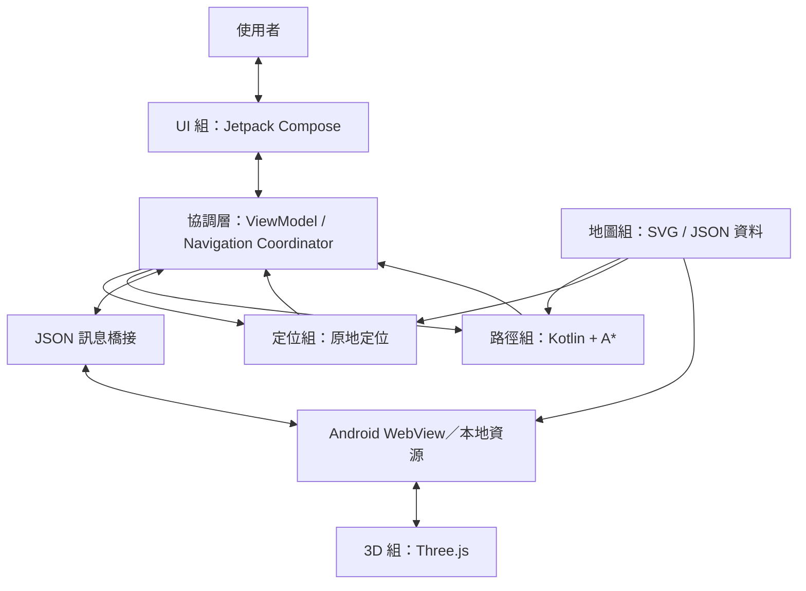
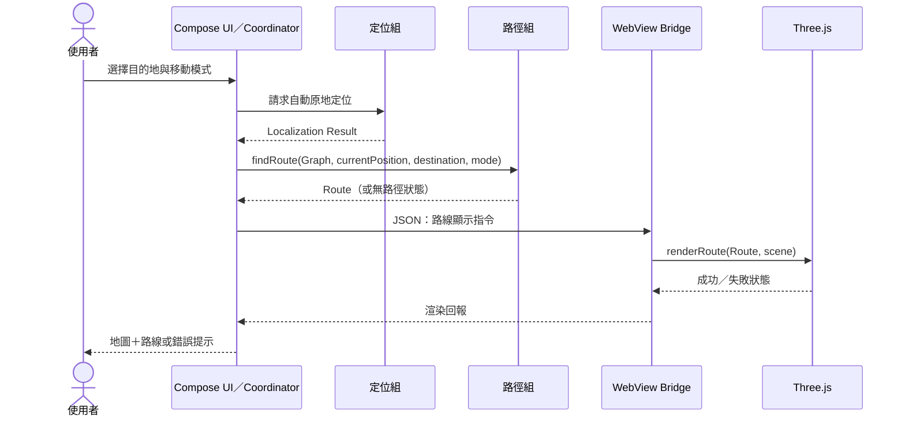

# 校園室內導航系統 V1 — 軟體系統架構

> **檔案：** `docs/architecture/System_Architecture.md`  
> **文件版本：** V1.0（架構決策基準；程式介面細節待驗證）  
> **更新日期：** 2026-11-19  
> **適用對象：** 地圖組、定位組、路徑組、3D 組、UI 組及整合負責人

## 1. 系統目標與決策

本系統為**單棟校園建築物的室內導航 Android App**。V1 的交付形式是供組員及老師安裝測試的 APK，無須上架 Google Play，無須部署後端伺服器，地圖和 3D 資源須可隨 APK 交付，核心導航流程以 **Offline-first** 運作。

| 項目 | V1 決策 |
|---|---|
| 用戶端 | Android Native App |
| UI | Kotlin + Jetpack Compose |
| 模組協調 | ViewModel / Navigation Coordinator（邏輯角色） |
| 定位 | Kotlin + Android 原生感測器 / Wi-Fi API；**自動原地定位** |
| 路徑 | Kotlin + A*；可處理同層／跨層與移動模式 |
| 地圖 | 地圖組交付 SVG、Graph、Node Mapping、Floor、Destination 等本地資料 |
| 3D | JavaScript + Three.js；SVG → 3D 幾何及路線顯示 |
| 3D 承載 | Android WebView 載入 APK 內的 Three.js 靜態資源 |
| 原生／網頁通訊 | JSON 訊息橋接（AndroidX WebKit 作為候選實作） |
| 目標部署 | Debug 或測試用途 APK，直接安裝；不需 Play Store |
| 後端／雲端 | V1 不需要；不可把即時網路作為核心導航必要條件 |

**適用範圍：** V1 僅要求站立時由系統自動取得定位結果；不要求步行期間連續定位、漂移修正或自動重新規劃。架構應允許未來擴充，但不得把擴充功能視為 V1 驗收前提。

## 2. 邏輯架構與職責



### 2.1 五組責任邊界

| 組別 | 必須負責 | 不負責 |
|---|---|---|
| 地圖組 | 標準 SVG、Graph、節點對應、Floor、Destination；離線 `evaluateMapError` 與誤差報告 | 3D 引擎、定位、路徑計算、App UI |
| 定位組 | 在無手動選起點的前提下，自動估計原地位置；輸出標準 Localization Result | 行走追蹤與 PDR 漂移修正（非 V1）、3D 渲染 |
| 路徑組 | `findRoute`：定位座標匹配可通行節點、目的地 ID 解析、A*、通行模式與跨樓層、標準 Route | 感測器取得、地圖描繪、使用者頁面 |
| 3D 組 | `renderMap`、`renderRoute`：讀取標準 SVG／Route，在 Three.js 中視覺化 | A* 演算法、SVG 原始地圖測量、Android 畫面導航 |
| UI 組 | 使用者選擇目的地／模式、呼叫協調流程、顯示 3D 容器、呈現異常訊息 | 內部定位演算法、路徑演算法、Three.js 3D 幾何實作 |

**協調層（App 層）**負責跨組模組的呼叫次序與 UI 狀態管理；它不是額外的第六組，也不是後端服務。整合負責人決定其模組歸屬和維護方式。

## 3. 共用資料契約與座標

跨組資料的唯一來源是 `docs/interfaces/schemas/Data_Specification.md`；跨組 Function 的唯一來源是 `docs/interfaces/functions/function.md`。本文件不重新定義既有欄位，以免規格衝突。

**八項共用規格：**（1）SVG、（2）統一座標、（3）Graph、（4）Route、（5）Node Mapping、（6）Localization Result、（7）Floor、（8）Destination。

- 建築物局部座標為 **X、Z 水平；Y 向上**，距離單位為公尺。
- App 的定位與路徑主要使用 `x`、`z`、`floor`；Three.js 依 Floor 的 `elevation_m` 轉換 `y`。
- SVG 圖面 `(u,v)` 依 Floor 提供的比例、旋轉與偏移轉換為 `(x,z)`。
- 地圖組須確保 SVG、Graph、Node Mapping、Floor、Destination 使用相容的 `map_version`、`building_id` 與座標系統。
- 各組不得自行定義新的通行模式、樓層表示或目的地 ID 語意。
- SVG 繪製規範目前**維持既有約定**；本次不新增獨立的 SVG 建模契約，也不要求地圖組直接建立 3D 模型。

## 4. V1 執行資料流程

### 4.1 啟動與地圖載入

1. Android App 啟動，載入隨 APK 打包的地圖資料及 Three.js 靜態資源。
2. App 驗證基本資料版本／樓層識別可匹配（詳細自動驗證流程另於測試規範制定）。
3. 在 Compose 畫面內建立 WebView；由 WebView 載入本地 Three.js 頁面。
4. App 或 WebView 依協商的資料交換方式把 SVG、Floor 與顯示設定交給 `renderMap`。
5. Three.js 回報地圖初始化狀態，UI 顯示地圖或錯誤訊息。

### 4.2 一次性導航流程



路徑組應負責位置匹配、合法 Edge 與模式限制；UI 不自行計算路徑。3D 組依標準 Route 渲染，不自行修改節點順序或路線成本。

### 4.3 錯誤與無法導航

- 定位失敗、定位信心不足、目的地無效、沒有可達路線、地圖缺失及渲染失敗，都需被 UI 區分並提示。
- UI 不應以假座標或假路線取代失敗結果。
- 具體 Exception 型別、錯誤代碼與重試策略留待後續統一例外規範；目前不得讓各組自行發明互不相容的跨組錯誤介面。

## 5. Android 與 Three.js 橋接

### 5.1 選定方向

- 使用 **WebView** 載入 APK 內的 HTML、JavaScript、CSS 與 Three.js Bundle。
- Compose 使用 `AndroidView` 嵌入 WebView（具體組件封裝方式由 UI／3D 整合時確定）。
- Kotlin 與 JavaScript 以 **JSON 訊息**交互，避免直接依賴彼此的內部類別。
- **候選橋接 API**：`WebViewCompat.addWebMessageListener`／對應 WebMessage API；具體雙向回傳設計應於首次整合時確定。
- 本地資源建議使用 `WebViewAssetLoader` 對應至受控 HTTPS 虛擬網域，而不是把原生檔案權限全面開放給 `file://`。

### 5.2 訊息契約的設計約束

這裡只定義設計原則，**不增加新的正式 Function 欄位**。當 `docs/interfaces/functions/function.md` 定稿時，應明訂橋接訊息的 `type`、請求識別、`payload`、回覆與錯誤格式。

| 訊息方向 | 情境 | 資料來源／用途 |
|---|---|---|
| Kotlin → JS | 載入／更新地圖 | SVG、Floor、顯示設定 |
| Kotlin → JS | 顯示／更新 Route | 標準 Route |
| JS → Kotlin | 地圖已就緒 | 初始化狀態 |
| JS → Kotlin | 渲染結果／錯誤 | UI 可顯示相應狀態 |
| JS → Kotlin | 使用者地圖互動（如有） | 交由 UI 協調層判斷，不直接操作定位或路徑組 |

### 5.3 安全邊界

- WebView 僅載入 App 隨附的可信內容；嚴格限制允許訊息來源。
- 不讓不可信的外部網頁接觸原生橋接介面。
- SVG 與 JSON 視為需要解析／驗證的資料，不執行其內嵌腳本、不載入外部資源。
- Wi-Fi／位置權限由 Android 原生層統一請求，不交給 Three.js 直接讀取。
- 3D 頁面不依賴 CDN 或即時網路才能啟動。

## 6. 專案目錄與資源打包（邏輯提案）

```text
project-root/
├── app/                    # Android 進入點、Compose、協調流程
├── core/                   # 共用資料模型、地圖讀取（可先是原始碼目錄）
│   ├── model/
│   └── data/
├── localization/           # 定位組 Kotlin 程式
├── routing/                # 路徑組 Kotlin A*
├── visualization/          # Android WebView 與橋接程式
├── threejs/                # Three.js、package.json、Vite 建置來源
├── map-data/               # 地圖組版本化 SVG / JSON 原始資料
├── tools/                  # 地圖組離線誤差評估／資料處理工具
└── docs/
    ├── architecture/
    │   ├── System_Architecture.md
    │   └── Technology_Stack.md
    ├── development/       # 五組開發規格與內部 Function
    └── interfaces/        # 八項資料契約與跨組 Function
```

上述是**邏輯分層**；不強制把每一個目錄立即建立為獨立 Gradle Module，避免 V1 過度模組化。

### 6.1 APK 內資產

- Android 需要的地圖 SVG／JSON 應於建置階段放入可由 App 讀取的資源位置。
- Three.js 專案以 Vite 建置出靜態 HTML／JS／CSS，再納入 APK 的 WebView 資產。
- 開發期間可用本機工具產生地圖資料；V1 使用者執行 APK 時無須 Python、Node.js 或額外伺服器。
- 原始地圖與 3D Bundle 的版本及交付位置由建置規範決定，避免重複維護兩份不同版本資料。

## 7. 架構限制與未決議題

| 項目 | 狀態 | 說明 |
|---|---|---|
| Android Native + Offline-first + 無後端 | **已確認** | APK 可供教師與組員直接安裝 |
| Kotlin + Compose、A*、Three.js | **已確認方向** | 具體版本見 `Technology_Stack.md` |
| WebView + JSON 雙向橋接 | **已確認架構方向** | 實際 API、訊息封包尚未完成開發／驗證 |
| WebViewAssetLoader | 建議 | 安全讀取打包資源的候選實作 |
| 多模組 Gradle 結構 | 待定 | V1 可先用單一 App Module 加來源分層 |
| Wi-Fi RSSI 感測器／權限 | 待定位組確認 | 系統差異與掃描限制需納入考量 |
| SVG-to-3D 牆高、開口細節 | 依原規格協調 | 此階段不另新增 SVG 建模契約 |
| 例外回報與橋接訊息 Schema | 後續統一 | 不由各組自行重新定義跨組格式 |

## 8. 文件優先級與變更管理

- 系統整體模組與責任邊界：以本文件為準。
- 語言／SDK／套件版本：以 `Technology_Stack.md` 及專案實際鎖版檔為準。
- 8 項資料的欄位、型別與單位：以 `Data_Specification.md` 為準。
- 跨組 Function 的輸入、輸出：以 `function.md` 為準。
- 各組內部演算法與測試工具：依 `development/` 所屬組別文件。
- 影響其他組別的變更須先協商，並同步更新決策紀錄 `docs/decisions.md`。

## 9. 下一階段（不在本文制定測試要求）

待本架構與技術版本正式鎖定、可建立最小 APK 後，另行制定八項資料驗證、跨組 Function 契約測試、單元測試、整合測試與 QA 流程。測試部署後再根據 Log、測試結果與使用回饋持續修正。
