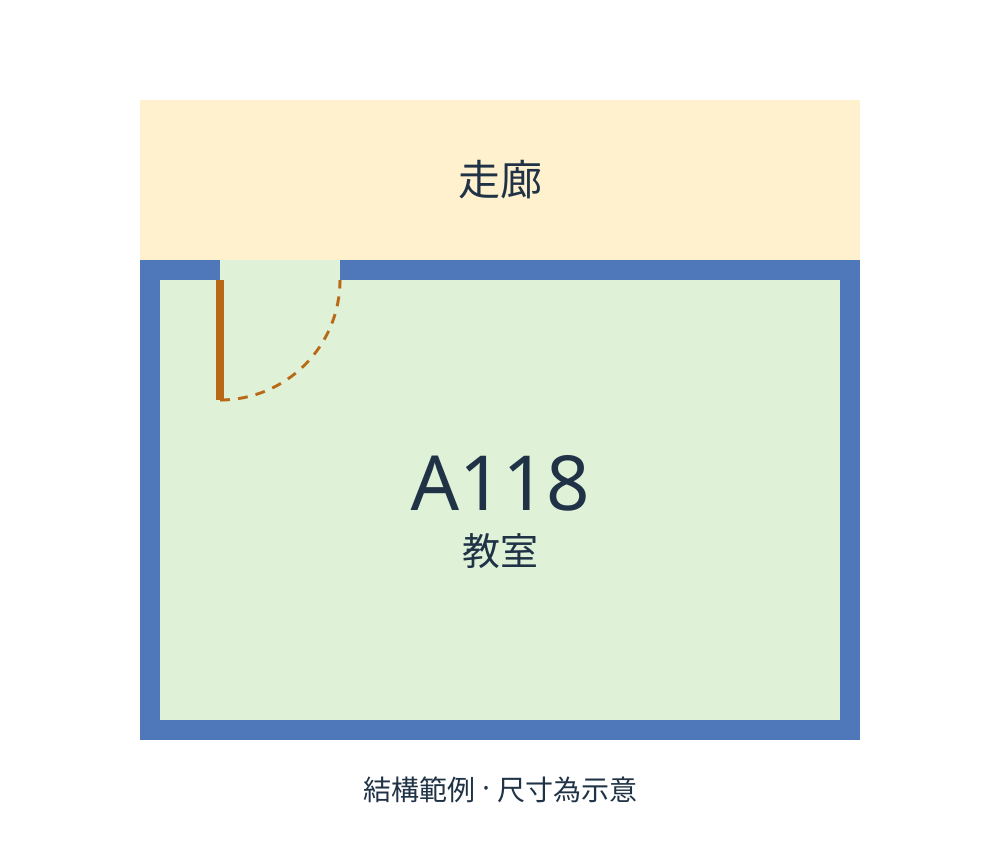

# Campus Indoor Navigation System V1 — Unified Data Specification

**Document version:** V1.1 (SVG object and layer supplement proposal)
**Updated:** 2026-11-25
**Applies to:** Map, Localization, Route, 3D, UI Teams  
**Document type:** Cross-team data contract  
**Note:** This is an English translation of the Chinese original (`docs/interfaces/schemas/Data_Specification.md`). If the two differ, the Chinese original prevails.

---

# 1. SVG Floor Plan Data Specification

**Provided by:** Map Team  
**Used by:** 3D Team  
**File format:** `.svg`

## 1.1 Basic Rules
- Each floor uses a separate SVG.
- A `viewBox` is required so drawing coordinates can be converted.
- All SVGs must follow the unified coordinate conversion rules.
- Rooms, walls, corridors, stairs, and elevators must be distinguishable by fixed layer IDs.
- Every Graph node must be able to map to a navigation anchor in the SVG.
- JavaScript execution and loading external resources are not allowed in the SVG.

## 1.2 Required SVG Attributes
| Attribute | Type | Description |
|---|---|---|
| `xmlns` | String | SVG XML namespace |
| `viewBox` | String | SVG drawing extent |
| `data-building-id` | String | Building ID |
| `data-floor` | Integer | Floor ID |
| `data-map-version` | String | Map data version |

## 1.3 Standard Layer IDs
| ID | Content |
|---|---|
| `walls` | Walls |
| `rooms` | Rooms |
| `corridors` | Corridors |
| `stairs` | Stairs |
| `elevators` | Elevators |
| `nav-anchors` | Navigation node anchors |

All six standard layers must be retained as `<g id="...">` elements. Use an empty layer when the floor has no corresponding content. The meaning of defined IDs must not be changed on one's own.

Place door leaves and swing directions in an additional `doors` group, and room numbers, names, and textual direction labels in `labels`. When present, this content must be separate from the six standard layers; these two auxiliary groups may be omitted when unused. Auxiliary groups do not replace standard layers.

## 1.4 Basic Objects and Layer Stacking (Required)
- Walls, rooms, corridors, stairs, and elevators must be organized as objects by purpose. Each basic object that needs independent identification, selection, editing, or 3D modeling must retain its own SVG element or `<g>` group and a clear `id` unique within the SVG.
- Put objects of the same category in the layer specified in Section 1.3. Nested `<g>` elements may organize room or stair components, while retaining independent child objects. A shared wall only needs to be drawn once; do not duplicate it for each room.
- Stacking means SVG paint order: later visible elements are normally painted over earlier ones. The recommended order is `corridors → rooms → walls → stairs → elevators → doors → nav-anchors → labels`. Order may be adjusted for occlusion, while preserving categories and IDs.
- Do not merge an entire map, or multiple objects that need independent operations, into one path or raster image. Color alone must not identify categories. Wrapping mixed map geometry in a single `walls` group does not satisfy classification.
- Reusable components are not required for every wall segment. Drawing-tool groups and generated SVG are both acceptable if the delivered SVG retains this structure. IDs are identifiers; programs must not infer coordinates, floors, or geometry from their names.

## 1.5 Two-Dimensional Geometry for 3D Processing (Required)
| Category | Delivery requirement |
|---|---|
| Walls | Use closed outlines with area, such as `rect`, `polygon`, or an explicitly closed `path`. Geometry must express wall thickness; a centerline whose thickness is represented only by `stroke-width` is insufficient. Doorways must be actual gaps in wall geometry, not floor-colored shapes covering a continuous wall. |
| Rooms and corridors | Provide separate closed regions with independent IDs. Do not merge room outlines with walls, text, or door leaves. |
| Stairs and elevators | Keep each facility in an independent group with a footprint outline. Step lines and direction symbols must remain identifiable child objects, outside `walls`. |
| Doors and text labels | Use separate `doors` and `labels` groups. Do not extrude them as walls. Keep text separate from structural geometry. |

The Map Team supplies 2D geometry, categories, and coordinates. The 3D Team handles wall heights, materials, and 3D model generation. A 2D stair symbol is not a 3D staircase. Convert SVG coordinates according to Sections 2 and 7. If nested `transform` attributes are used, the reader must account for their cumulative transform before applying `svg_transform` from `floors.json`.

## 1.6 SVG Source Cleanup (Required)
- Use UTF-8, two spaces per indentation level, and consistent line breaks. Do not deliver the entire SVG minified onto one line.
- Organize source by layers and functional blocks, with short purpose comments. Use clear, consistent object names without duplicate IDs.
- Remove unused hidden source drawings, temporary objects, and duplicate geometry from delivery files; keep source drafts separately. Required hidden `nav-anchors` are not unused content.
- After export or formatting, confirm that the SVG still displays correctly and retains object categories, doorway gaps, and IDs.

## 1.7 A118 Small-Area Example

Complete editable example: [A118_layered_template.svg](examples/A118_layered_template.svg). Open it directly in a browser or SVG editor.



This example demonstrates A118 and its adjoining corridor. **It is not a measured plan of A118.** Blue represents five independent wall segments, light green the room, light yellow the corridor, and orange the door. Colors, dimensions, and object ID names are examples, not prescribed values.

| Object | Example ID | Layer |
|---|---|---|
| Room and floor | `room-A118`, `room-A118-floor` | `rooms` |
| Adjoining corridor | `corridor-A118-front` | `corridors` |
| Wall segments | `wall-A118-west`, `wall-A118-north-left`, etc. | `walls` |
| Door leaf and swing arc | `door-A118-leaf`, `door-A118-swing` | `doors` |
| Navigation anchors | `anchor-N_A118_CORRIDOR`, `anchor-N_A118_ENTRY` | `nav-anchors` |
| Room number and name | `label-A118-number`, `label-A118-kind` | `labels` |

`stairs` and `elevators` remain empty because these facilities are absent from the example area. `data-room-ref` is an optional helper relationship used by the example, not a new required field or a replacement for Node Mapping or Destination.

The following is a compact structural example using the same geometry. The full example also includes the door, labels, and comments:
```xml
<svg xmlns="http://www.w3.org/2000/svg"
     viewBox="0 0 1000 850"
     data-building-id="EB5_DEMO"
     data-floor="1"
     data-map-version="example-A118-v1">
  <g id="corridors">
    <rect id="corridor-A118-front" x="140" y="100" width="720" height="160" fill="#fff0ce" />
  </g>
  <g id="rooms" fill="#dff2d8">
    <g id="room-A118">
      <rect id="room-A118-floor" x="160" y="280" width="680" height="440" />
      <rect id="room-A118-threshold" x="220" y="260" width="120" height="20" />
    </g>
  </g>
  <g id="walls" fill="#4f78ba">
    <rect id="wall-A118-west" x="140" y="280" width="20" height="440" />
    <rect id="wall-A118-east" x="840" y="280" width="20" height="440" />
    <rect id="wall-A118-south" x="140" y="720" width="720" height="20" />
    <!-- Doorway x=220..340 is a real gap between two wall segments. -->
    <rect id="wall-A118-north-left" x="140" y="260" width="80" height="20" />
    <rect id="wall-A118-north-right" x="340" y="260" width="520" height="20" />
  </g>
  <g id="stairs" />
  <g id="elevators" />
  <g id="nav-anchors" display="none">
    <circle id="anchor-N_A118_CORRIDOR" cx="280" cy="180" r="10" />
    <circle id="anchor-N_A118_ENTRY" cx="280" cy="270" r="10" />
  </g>
</svg>
```

The building ID, map version, anchors, and coordinates are teaching values, not linked to the production Graph. Replace them with confirmed data for formal delivery, alongside consistent `floors.json`, `graph.json`, `node_map.json`, and `destinations.json`. This example does not demonstrate completed cross-file validation.

## 1.8 SVG Delivery Checklist
- [ ] Required root attributes and all six standard layers exist; the SVG parses and displays correctly.
- [ ] Basic objects have unique IDs and can be selected and edited independently. No merged entire map, text mixed into walls, or category changes made only by renaming a layer.
- [ ] Hiding `doors` and `labels` leaves correct wall outlines with actual doorway gaps; rooms and corridors are closed regions.
- [ ] Walls, rooms, corridors, and facilities can be read separately by layer. Confirm small-area reading and modeling with the 3D Team before applying the structure to an entire floor.
- [ ] Indentation, line breaks, names, and comments are organized; no duplicate IDs, unused hidden content, or external resources remain.
- [ ] Formal delivery passes the Graph / anchor mapping and coordinate checks in Section 5, and the version rules in Section 9.2.

In the PR, include a layer preview or object-selection screenshot, basic check results, and any outstanding cross-team validation. Displaying an SVG alone does not establish that it is ready for 3D modeling.

## 1.9 Scope and Compatibility of This Supplement
The 2026-11-23 supplement specifies independent objects, layer stacking, closed geometry, and source cleanup, affecting Map Team delivery and 3D Team readers. The six standard layers and root attributes remain from the previous specification; the object organization and geometry details are newly explicit requirements, not requirements retroactively claimed to have been written in the original.

After this supplement is reviewed and merged through a PR, it applies to subsequent revisions of unmerged map-data PRs and future formal deliveries. Existing drawings need cleanup and compatibility confirmation with the 3D Team, rather than being assumed compliant. Existing fields and coordinate rules in Sections 2–10 remain unchanged.

---

# 2. Unified Coordinate System Specification

**Applies to:** all five teams

## 2.1 Coordinate Definition
A Building Local Coordinate System in three dimensions is used.

| Coordinate | Meaning | Positive direction | Unit |
|---|---|---|---|
| `x` | Horizontal position | Right of the building reference direction | m |
| `y` | Vertical height | Up | m |
| `z` | Horizontal position | Down of the building reference direction | m |

The building reference direction is established by the Map Team and confirmed by the Integration Team. This project uses the Y-up coordinate convention compatible with Three.js, and horizontal navigation uses the XZ plane.

## 2.2 Origin Rules
- Each building has one unique fixed origin.
- V1 decision: the top-left corner `(u0,v0)` of the 1F SVG `viewBox` is the building-wide local origin `(x,y,z) = (0,0,0)`; `y = 0` is the 1F finished-floor reference height.
- SVG-right on 1F maps to building `+x`, SVG-down maps to `+z`, and height `+y` points up. The 1F `svg_transform` uses `origin_x_m = 0`, `origin_z_m = 0`, and `rotation_deg = 0`. The scale must be established by field measurements.
- All floors share this building-wide horizontal coordinate system. Each other floor's SVG must be aligned through its own `svg_transform`; its `viewBox` top-left corner must not be treated as another building origin.
- Different floors are distinguished by the `y` height. No team may adjust the settled origin on its own.

## 2.3 Coordinate Usage Rules per Team
| Team | Coordinate data |
|---|---|
| Map Team | `x, z, floor` |
| Localization Team | `x, z, floor` |
| Route Team | `x, z, floor` |
| 3D Team | `x, y, z` |
| UI Team | Receives unified localization, route, and floor data |

`floor` is used to look up the floor height: `y = floor.elevation_m`.

## 2.4 SVG Coordinate Conversion
SVG uses 2D drawing coordinates `(u,v)`, which are mapped to world coordinates `(x,z)` through the floor transform information. Each floor must define `scale_m_per_svg_unit` (meters per SVG unit), `rotation_deg` (planar rotation angle), and `origin_x_m` and `origin_z_m` (world coordinates of the SVG origin).

Let `(u0,v0)` be the top-left corner of the SVG `viewBox`, `s` the scale, and `θ` the rotation angle:
```text
du = u - u0
dv = v - v0

x = origin_x_m + s(du cosθ - dv sinθ)
z = origin_z_m + s(du sinθ + dv cosθ)
```
`rotation_deg = 0` means SVG-right maps to world `+x` and SVG-down maps to world `+z`. No team may use a different coordinate conversion formula on its own.

---

# 3. Graph Navigation Graph Data Specification

**Provided by:** Map Team  
**Used by:** Route Team, 3D Team (`renderRoute` verifies the Route against the Graph)  
**File format:** `graph.json`

## 3.1 Standard Data Structure
```json
{
  "building_id": "B01",
  "map_version": "2026-11-19-01",
  "coordinate_system_id": "B01_LOCAL_V1",
  "nodes": [
    {"id": "N1", "x": 2.0, "z": 3.0, "floor": 1, "type": "walk"},
    {"id": "N2", "x": 6.0, "z": 3.0, "floor": 1, "type": "stair"},
    {"id": "N3", "x": 6.0, "z": 3.0, "floor": 2, "type": "stair"},
    {"id": "N4", "x": 8.0, "z": 3.0, "floor": 2, "type": "door"}
  ],
  "edges": [
    {"a": "N1", "b": "N2", "w": 4.0, "kind": "walk"},
    {"a": "N2", "b": "N3", "w": 8.0, "kind": "stair"},
    {"a": "N3", "b": "N4", "w": 2.0, "kind": "walk"}
  ]
}
```

## 3.2 Node Fields
| Field | Type | Required | Description |
|---|---|---|---|
| `id` | String | Yes | Node ID, unique across the whole Graph |
| `x` | Number | Yes | World X coordinate, m |
| `z` | Number | Yes | World Z coordinate, m |
| `floor` | Integer | Yes | Floor ID |
| `type` | String | Yes | Node type |

Standard `type` values: `walk` ordinary walkable node, `door` entrance/exit node, `stair` stair node, `elev` elevator node.

## 3.3 Edge Fields
| Field | Type | Required | Description |
|---|---|---|---|
| `a` | String | Yes | Node ID at the start end |
| `b` | String | Yes | Node ID at the end end |
| `w` | Number | Yes | Edge weight |
| `kind` | String | Yes | Traversal type |

Standard `kind` values: `walk`, `stair`, `elev`. V1 uses an **undirected graph**; every Edge can be traversed in both directions. `w` is defined as a positive weighted equivalent distance (a non-negative cost that must be positive), in equivalent meters. By default V1 uses travel distance as the main weight; stairs and elevators may use equivalent distances.

To ensure that the A* heuristic using the current XZ straight-line distance does not overestimate cost, each edge's `w` must not be less than the XZ-plane straight-line distance between its two end nodes. If the weight definition changes later, the Route Team must re-verify the admissibility of the heuristic.

## 3.4 Validation Rules
- Node IDs must not repeat.
- The `a` and `b` of an Edge must exist in `nodes`.
- `a` must not equal `b`.
- `w` must be a finite positive number.
- The same pair of nodes must not have duplicate undirected edges.
- Cross-floor Edges may only use `stair` or `elev`.
- All nodes use the unified coordinate system and floor IDs.

---

# 4. Route Navigation Route Data Specification

**Provided by:** Route Team  
**Used by:** UI, 3D Teams  
**Data format:** JSON

## 4.1 Standard Data Structure
```json
{
  "building_id": "B01",
  "map_version": "2026-11-19-01",
  "coordinate_system_id": "B01_LOCAL_V1",
  "mode": "stair",
  "path": [
    {"id": "N1", "x": 2.0, "z": 3.0, "floor": 1, "type": "walk"},
    {"id": "N2", "x": 6.0, "z": 3.0, "floor": 1, "type": "stair"},
    {"id": "N3", "x": 6.0, "z": 3.0, "floor": 2, "type": "stair"},
    {"id": "N4", "x": 8.0, "z": 3.0, "floor": 2, "type": "door"}
  ],
  "length": 14.0,
  "floors": [1, 2],
  "transitions": [{"from": "N2", "to": "N3", "kind": "stair"}]
}
```

## 4.2 Route Fields
| Field | Type | Required | Description |
|---|---|---|---|
| `building_id` | String | Yes | Building ID |
| `map_version` | String | Yes | Map version used |
| `coordinate_system_id` | String | Yes | Coordinate system ID |
| `mode` | String | Yes | Movement mode used |
| `path` | Array | Yes | Nodes in walking order |
| `length` | Number | Yes | Sum of path Edge weights |
| `floors` | Integer[] | Yes | Floors in order of first visit |
| `transitions` | Array | Yes | Cross-floor transition information |

Every node in `path` must conform to the Graph Node specification. `length` is the sum of Graph `w` values and represents a weighted equivalent distance; it is not guaranteed to equal the actual walking distance. The UI must not label it directly as actual walking meters unless the weight definition has been confirmed to equal real distance.

## 4.3 Movement Modes
| mode | Definition |
|---|---|
| `any` | No restriction on stairs or elevators |
| `stair` | Allows ordinary passages and stairs, forbids elevators |
| `elev` | Allows ordinary passages and elevators, forbids stairs |

The three mode names must be kept consistent between the UI and the Route Team.

## 4.4 Cross-floor Transitions
Every floor change must be recorded in `transitions`, stating both end nodes and the traversal method. For a same-floor route, `transitions` is an empty array. When no path is reachable, the V1 route query result is `null`; invalid input or execution failure falls under error handling, to be defined later by the unified Exception specification.

## 4.5 Validation Rules
- The nodes in `path` must exist in the corresponding Graph.
- Adjacent path nodes must have a valid Edge between them.
- `mode` must satisfy the traversal restrictions of all Edges used.
- `length` must equal the sum of the `w` of the path's Edges.
- `floors` must match the floors the `path` actually passes through.
- Every floor change must have a valid `transitions` entry.
- When start equals end, a single node is allowed and `length` is 0.

---

# 5. Node Mapping Specification

**Provided by:** Map Team  
**Used by:** Route, 3D Teams  
**File format:** `node_map.json`

## 5.1 Purpose
Establishes a one-to-one correspondence between Graph Nodes and SVG map anchors. The relationship between destinations and walkable nodes is managed separately by the item 8 location data, to avoid maintaining the same relationship in multiple files.

## 5.2 Standard Data Structure
```json
{
  "building_id": "B01",
  "map_version": "2026-11-19-01",
  "entries": [
    {"node_id": "N1", "floor": 1, "svg_anchor_id": "anchor-N1"},
    {"node_id": "N2", "floor": 1, "svg_anchor_id": "anchor-N2"},
    {"node_id": "N3", "floor": 2, "svg_anchor_id": "anchor-N3"},
    {"node_id": "N4", "floor": 2, "svg_anchor_id": "anchor-N4"}
  ]
}
```

## 5.3 Fields
| Field | Type | Description |
|---|---|---|
| `node_id` | String | Graph Node ID |
| `floor` | Integer | Floor of the Node |
| `svg_anchor_id` | String | Corresponding anchor ID in the SVG |

All fields are required.

## 5.4 Validation Rules
- Every Graph Node must have exactly one Mapping entry.
- `node_id` must exist in the Graph.
- `svg_anchor_id` must exist in the SVG of the corresponding floor.
- `floor` must match the Graph Node.
- After converting an SVG anchor to world coordinates, its XZ distance error from the Graph Node must not exceed 0.05 m. This is a tolerance for consistency between data sets, not an error threshold for real building surveying.

---

# 6. Localization Result Specification

**Provided by:** Localization Team  
**Used by:** UI, Route, 3D Teams  
**Data format:** JSON

## 6.1 Standard Data Structure
```json
{
  "building_id": "B01",
  "map_version": "2026-11-19-01",
  "coordinate_system_id": "B01_LOCAL_V1",
  "position": {"x": 2.0, "z": 3.0, "floor": 1},
  "confidence": 0.86,
  "timestamp": "2026-11-19T06:00:00Z"
}
```

## 6.2 Field Definitions
| Field | Type | Required | Description |
|---|---|---|---|
| `building_id` | String | Yes | Building ID |
| `map_version` | String | Yes | Map version the localization corresponds to |
| `coordinate_system_id` | String | Yes | Unified coordinate system ID |
| `position` | Object | Yes | Position information |
| `position.x` | Number | Yes | X coordinate, m |
| `position.z` | Number | Yes | Z coordinate, m |
| `position.floor` | Integer | Yes | Floor where the device is |
| `confidence` | Number | Yes | Localization confidence score |
| `timestamp` | String | Yes | ISO 8601 UTC localization time |

## 6.3 Confidence Rules
V1 uniformly uses `0.0 ≤ confidence ≤ 1.0`. A larger value means the Localization Team has higher confidence in the result. This is a normalized confidence score, not directly equal to a probability of success, and `0.8` must not be read as an 80% probability of being within some distance. The Localization Team must explain how the score is computed and validate its usefulness in accuracy tests.

## 6.4 Localization Success and Failure
- Success: return a complete and valid Localization Result.
- Failure: coordinates or confidence must not be fabricated.
- Concrete failure codes and the reporting method are left to the project-wide exception handling specification.

V1 only requires automatic in-place localization, not continuous position tracking.

---

# 7. Floor Specification

**Provided by:** Map Team  
**Used by:** all five teams  
**File format:** `floors.json`

## 7.1 Floor ID Definition
V1 uses an Integer to represent floors.
| Actual floor | floor |
|---|---:|
| B2 | -2 |
| B1 | -1 |
| 1F | 1 |
| 2F | 2 |
| 3F | 3 |

Ordinary floor numbering does not use `0`. If a building has special floor numbering, the Integration Team will confirm it separately.

## 7.2 Standard Data Structure
```json
{
  "building_id": "B01",
  "map_version": "2026-11-19-01",
  "coordinate_system_id": "B01_LOCAL_V1",
  "floors": [
    {"floor": 1, "label": "1F", "elevation_m": 0.0, "svg": "floors/1.svg",
     "svg_transform": {"origin_x_m": 0.0, "origin_z_m": 0.0, "scale_m_per_svg_unit": 0.1, "rotation_deg": 0.0}},
    {"floor": 2, "label": "2F", "elevation_m": 4.0, "svg": "floors/2.svg",
     "svg_transform": {"origin_x_m": 0.0, "origin_z_m": 0.0, "scale_m_per_svg_unit": 0.1, "rotation_deg": 0.0}}
  ]
}
```

## 7.3 Floor Fields
| Field | Type | Description |
|---|---|---|
| `floor` | Integer | Unique floor ID |
| `label` | String | UI display name |
| `elevation_m` | Number | Floor reference height, m |
| `svg` | String | Relative path of the floor's SVG |
| `svg_transform` | Object | Information needed to convert SVG to world coordinates |

`svg_transform` must contain the four transform parameters specified in Section 2.

## 7.4 Validation Rules
- Floor IDs must not repeat.
- The SVG file must exist.
- All floors referenced by the Graph must exist.
- The `elevation_m` of different floors must follow the real height order.
- `scale_m_per_svg_unit` must be greater than 0.
- The floor ID of a floor's SVG must match the Floor data.

---

# 8. Location / Destination Specification

**Provided by:** Map Team  
**Used by:** UI, Route Teams  
**File format:** `destinations.json`

## 8.1 Purpose
Provides the navigation destinations a user can choose and maps each destination to a walkable Graph node. When a user selects a destination, the UI uses the Location ID, rather than composing room names or Graph Node IDs itself.

## 8.2 Standard Data Structure
```json
{
  "building_id": "B01",
  "map_version": "2026-11-19-01",
  "locations": [
    {"id": "L_F2_201", "name": "Room 201", "floor": 2, "node_id": "N4", "category": "room"}
  ]
}
```

## 8.3 Fields
| Field | Type | Required | Description |
|---|---|---|---|
| `id` | String | Yes | Unique destination ID |
| `name` | String | Yes | Display name |
| `floor` | Integer | Yes | Floor of the destination |
| `node_id` | String | Yes | Corresponding walkable Graph Node |
| `category` | String | Yes | Location category |

Standard `category` values: `room` (classroom or ordinary room), `entrance` (building entrance/exit), `facility` (public facility), `stair` (stairs), `elev` (elevator), `other` (other places).

## 8.4 Validation Rules
- Location IDs must not repeat.
- `node_id` must exist in the Graph.
- The Location's `floor` must match the corresponding Node.
- The UI must not change Location IDs on its own.
- The Route Team must be able to use a Location ID to find the corresponding navigation node.

In V1 each destination maps to one primary walkable node. Multi-entrance destinations may be added in a later version.

---

# 9. Global Common Rules

## 9.1 Naming and Data Types
All JSON fields use `snake_case`; the established short fields `id`, `x`, `z`, `a`, `b`, `w` in Graph and Route are retained.
- IDs are always Strings; numeric IDs are not used.
- Floor IDs are always Integers.
- Coordinates, weights, and heights are finite Numbers; NaN and Infinity are not allowed.
- Required fields must not be missing; an empty string must not stand in for a missing required ID.

## 9.2 Map Version Consistency
The SVG, Graph, Node Mapping, Floor, and Destination delivered by the Map Team must all have the same `map_version`. Localization results and Routes must state the map version and coordinate system they used. Data of different versions must not be mixed directly before compatibility is confirmed.

## 9.3 ID Management
| ID type | Example | Principle |
|---|---|---|
| Building ID | `B01` | Unique per building |
| Coordinate System ID | `B01_LOCAL_V1` | Specifies the coordinate baseline version |
| Node ID | `N4` | Unique within a Graph |
| Location ID | `L_F2_201` | Unique within a building |
| Floor ID | `2` | Unique within a building |
| SVG Anchor ID | `anchor-N4` | Unique within an SVG |

The strings above are naming-convention examples; programs must not parse ID strings to obtain floors or coordinates, and must read the corresponding fields.

## 9.4 Data Change Principle
A published cross-team data specification must not be modified by a single team on its own. A change should state its content, affected teams, and compatibility notes, and be reviewed and updated uniformly by the Integration Team.

## 9.5 Specification Validation
Before formal use, the following must be validated: JSON structure and types, ID references, SVG / Graph / Node Mapping coordinate consistency, Floor / Location references, Route consistency with Graph nodes / edges / weights, localization coordinate system consistency, and compatibility of the related data versions. This data contract validation does not replace each team's functional tests and real accuracy tests.

---

# 10. Data Delivery Responsibilities per Team
| Data | Provided by | Main recipient |
|---|---|---|
| SVG | Map Team | 3D Team |
| Coordinate system | Defined by Integration Team, implemented by Map Team | All five teams |
| Graph | Map Team | Route, 3D Teams |
| Route | Route Team | UI, 3D Teams |
| Node Mapping | Map Team | Route, 3D Teams |
| Localization Result | Localization Team | UI, Route, 3D Teams |
| Floor | Map Team | All five teams |
| Destination | Map Team | UI, Route Teams |

All teams may decide their internal implementations freely, but cross-team data must follow this document.

**After review and release by the Integration Team, the V1.1 data specification serves as the formal data contract shared by the five teams.**
