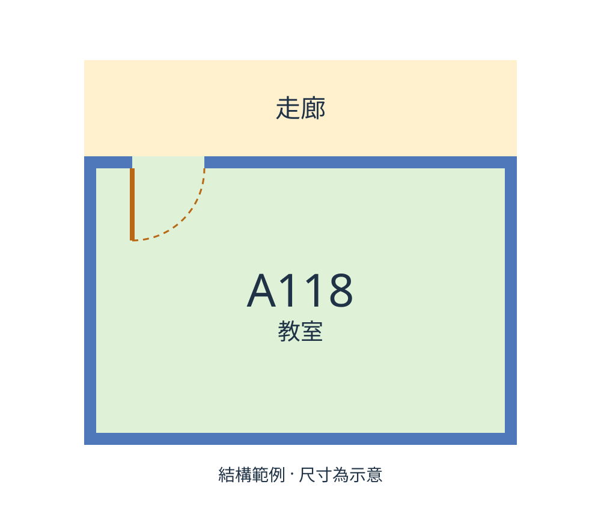

# 校園室內導航系統 V1 — 統一資料規格

**文件版本：** V1.1（SVG 物件與分層補充提案）
**更新日期：** 2026-11-23
**適用組別：** 地圖、定位、路徑、3D、UI  
**文件類型：** 跨組資料契約（Data Contract）

---

# 1. SVG 平面圖資料規格

**提供組：** 地圖組  
**使用組：** 3D 組  
**檔案格式：** `.svg`

## 1.1 基本規定
- 每個樓層使用一份獨立 SVG。
- 必須具有 `viewBox`，確保圖面座標可轉換。
- 所有 SVG 必須遵守統一座標轉換規則。
- 房間、牆壁、走廊、樓梯、電梯必須能以固定圖層 ID 區分。
- 每個 Graph 節點必須能對應到 SVG 的導航錨點。
- 不允許在 SVG 中執行 JavaScript 或載入外部資源。

## 1.2 必要 SVG 屬性
| 屬性 | 型別 | 說明 |
|---|---|---|
| `xmlns` | String | SVG XML 命名空間 |
| `viewBox` | String | SVG 圖面範圍 |
| `data-building-id` | String | 建築物 ID |
| `data-floor` | Integer | 樓層 ID |
| `data-map-version` | String | 地圖資料版本 |

## 1.3 標準圖層 ID
| ID | 內容 |
|---|---|
| `walls` | 牆壁 |
| `rooms` | 房間 |
| `corridors` | 走廊 |
| `stairs` | 樓梯 |
| `elevators` | 電梯 |
| `nav-anchors` | 導航節點錨點 |

六個標準圖層均須以 `<g id="...">` 保留；該樓層沒有對應內容時，使用空圖層。不得自行變更已定義的 ID 意義。

門扇與開門方向放入額外的 `doors` 群組；房號、名稱、方向文字等標示放入 `labels` 群組。有這些內容時須與上述六個圖層分開；沒有時可省略這兩個輔助群組。輔助群組不取代標準圖層。

## 1.4 基本物件與圖層堆疊（必要）
- 牆壁、房間、走廊、樓梯、電梯須依用途物件化。每個需獨立辨識、選取、修改或建立 3D 模型的基本物件，必須保留獨立 SVG 元素或 `<g>` 群組，並具有同一 SVG 內唯一且清楚的 `id`。
- 同類物件放入第 1.3 節指定的圖層。可以使用巢狀 `<g>` 組織房間或樓梯的子物件，但不可因此失去子物件的獨立結構；共用牆體只需建立一次，不必為每個房間重複繪製。
- 「堆疊」指 SVG 的繪製順序：後面的可見元素通常繪製在前面元素上方。建議依 `corridors → rooms → walls → stairs → elevators → doors → nav-anchors → labels` 組合；可依遮擋需求調整順序，但分類與 ID 必須維持。
- 不得將完整地圖或多個需獨立操作的物件合併為單一路徑、單張點陣圖片，或僅依顏色區分用途。將整張混合圖形放進一個 `walls` 群組，也不算完成分類。
- 不要求每段牆都製作成可重用元件；使用繪圖工具分組或以程式產生均可，交付的 SVG 必須保留上述結構。ID 名稱只是識別碼，程式不得由名稱推測座標、樓層或幾何。

## 1.5 可供 3D 處理的二維幾何（必要）
| 類別 | 交付要求 |
|---|---|
| 牆壁 | 使用有面積的封閉輪廓，如 `rect`、`polygon` 或明確閉合的 `path`；牆厚由輪廓表達，不可只交付以 `stroke-width` 表示厚度的中心線。門口必須在牆體幾何中保留缺口，不得用地板色塊遮住完整牆面。 |
| 房間、走廊 | 各自提供封閉區域，保留獨立 ID；房間輪廓不與牆體、文字或門扇合併。 |
| 樓梯、電梯 | 每座設施保留獨立群組與範圍輪廓；階梯線、方向符號等作為可辨識的子物件，不放入 `walls`。 |
| 門、文字標示 | 使用獨立 `doors`、`labels` 群組；不得當作牆體拉高。文字需與結構幾何分離。 |

地圖組交付二維幾何、分類及座標資料；3D 組負責牆高、材質與立體模型生成。樓梯的二維符號不代表已提供三維階梯。SVG 圖面座標仍須依第 2、7 節轉換；若使用巢狀 `transform`，讀取端須先計入累積轉換，再套用 `floors.json` 的 `svg_transform`。

## 1.6 SVG 原始碼整理（必要）
- 使用 UTF-8、每層兩個空白縮排及一致換行，不將整份 SVG 壓成一行後交付。
- 依圖層與功能區塊整理，保留簡短用途註解；物件命名須清楚且一致，不可有重複 ID。
- 正式交付檔移除無用的隱藏原圖、暫存物件與重複幾何；原始底稿另行保存。必要的隱藏 `nav-anchors` 不在清除範圍。
- 匯出或格式整理後須重新確認可正常顯示，物件分類、門口缺口及 ID 均仍保留。

## 1.7 A118 小範圍範例

完整可編輯範例：[A118_layered_template.svg](examples/A118_layered_template.svg)。可直接以瀏覽器或 SVG 編輯器開啟。



本範例僅示範 A118 教室與前方走廊的組織方式，**不是 A118 的實測圖面**。藍色為五段獨立牆體、淡綠色為房間、淡黃色為走廊、橘色為門；顏色、尺寸及物件 ID 命名均為示例，不是必須照用的值。

| 物件 | 範例 ID | 所屬圖層 |
|---|---|---|
| 房間與地板 | `room-A118`、`room-A118-floor` | `rooms` |
| 前方走廊 | `corridor-A118-front` | `corridors` |
| 各段牆體 | `wall-A118-west`、`wall-A118-north-left` 等 | `walls` |
| 門扇與開門弧線 | `door-A118-leaf`、`door-A118-swing` | `doors` |
| 導航錨點 | `anchor-N_A118_CORRIDOR`、`anchor-N_A118_ENTRY` | `nav-anchors` |
| 房號與名稱 | `label-A118-number`、`label-A118-kind` | `labels` |

`stairs`、`elevators` 因範圍內沒有對應設施而保留空圖層。`data-room-ref` 是範例的可選輔助關聯，不是新增必要欄位，也不取代 Node Mapping 或 Destination。

以下為同一畫法的精簡結構示例；完整範例另含門扇、標示與註解：
```xml
<svg xmlns="http://www.w3.org/2000/svg"
     viewBox="0 0 1000 850"
     data-building-id="EB5_DEMO"
     data-floor="1"
     data-map-version="example-A118-v1">
  <g id="corridors">
    <rect id="corridor-A118-front" x="140" y="100" width="720" height="160" fill="#fff0ce" />
  </g>
  <g id="rooms" fill="#dff2d8">
    <g id="room-A118">
      <rect id="room-A118-floor" x="160" y="280" width="680" height="440" />
      <rect id="room-A118-threshold" x="220" y="260" width="120" height="20" />
    </g>
  </g>
  <g id="walls" fill="#4f78ba">
    <rect id="wall-A118-west" x="140" y="280" width="20" height="440" />
    <rect id="wall-A118-east" x="840" y="280" width="20" height="440" />
    <rect id="wall-A118-south" x="140" y="720" width="720" height="20" />
    <!-- 門口 x=220..340 保留真正缺口，上側牆分成兩段。 -->
    <rect id="wall-A118-north-left" x="140" y="260" width="80" height="20" />
    <rect id="wall-A118-north-right" x="340" y="260" width="520" height="20" />
  </g>
  <g id="stairs" />
  <g id="elevators" />
  <g id="nav-anchors" display="none">
    <circle id="anchor-N_A118_CORRIDOR" cx="280" cy="180" r="10" />
    <circle id="anchor-N_A118_ENTRY" cx="280" cy="270" r="10" />
  </g>
</svg>
```

範例中的建築 ID、地圖版本、導航錨點與座標均為教學值，未綁定正式 Graph。正式交付須替換為確認後的資料，並提供一致的 `floors.json`、`graph.json`、`node_map.json` 及 `destinations.json`；本範例不代表已完成跨資料驗證。

## 1.8 SVG 交付檢查清單
- [ ] 必要根屬性與六個標準圖層齊全，SVG 可正常解析與顯示。
- [ ] 各基本物件有唯一 ID，可分別選取與修改；沒有整圖合併、文字混入牆層或只改圖層名稱的情況。
- [ ] 隱藏 `doors` 與 `labels` 後，牆體輪廓仍正確，門口保持真正缺口；房間與走廊為封閉區域。
- [ ] 可依圖層分別讀取牆體、房間、走廊與設施；小範圍資料先與 3D 組確認讀取及建模方式，再套用至整層。
- [ ] 原始碼縮排、換行、命名與註解已整理，無重複 ID、無用隱藏內容或外部資源。
- [ ] 正式交付時完成第 5 節的 Graph／錨點對應及座標一致性驗證，並符合第 9.2 節版本要求。

PR 請附分層預覽或物件選取截圖、基本檢查結果與尚未完成的跨組驗證；不得把「SVG 能顯示」直接視為已可供 3D 建模。

## 1.9 本次補充的適用與相容性
2026-11-23 補充物件獨立結構、圖層堆疊、封閉幾何與原始碼整理要求，影響地圖組交付及 3D 組讀取方式。既有六圖層與根屬性沿用原規格；上述組織與幾何細節屬本次新增明訂要求，不追溯認定為原規格已寫明的事項。

本次補充經 PR 審查合併後，適用於尚未合併圖資 PR 的後續修訂與之後的正式交付；舊圖資需整理後再與 3D 組確認相容性，不可直接假定符合。第 2～10 節既有資料欄位與座標規則維持不變。

---

# 2. 統一座標系統規格

**適用組別：** 全部五組

## 2.1 座標定義
使用建築物局部三維座標系統（Building Local Coordinate System）。

| 座標 | 意義 | 正方向 | 單位 |
|---|---|---|---|
| `x` | 水平位置 | 建築物基準方向的右方 | m |
| `y` | 垂直高度 | 向上 | m |
| `z` | 水平位置 | 建築物基準方向的下方 | m |

建築物基準方向由地圖組建立，並由整合組確認。本專案採用與 Three.js 相容的 Y-up 座標慣例，水平導航使用 XZ 平面。

## 2.2 原點規定
- 每棟建築物設定唯一固定原點。
- V1 建議以 1F 平面圖的左上基準點作為 `(0,0,0)`。
- 所有樓層共用同一套水平座標系統。
- 不同樓層以 `y` 高度區分。
- 原點一旦定案，不得由各組自行調整。

## 2.3 各組座標使用規則
| 組別 | 座標資料 |
|---|---|
| 地圖組 | `x, z, floor` |
| 定位組 | `x, z, floor` |
| 路徑組 | `x, z, floor` |
| 3D 組 | `x, y, z` |
| UI 組 | 接收統一定位、路線與樓層資料 |

其中 `floor` 用來查詢樓層高度：`y = floor.elevation_m`。

## 2.4 SVG 座標轉換
SVG 使用二維圖面座標 `(u,v)`，透過樓層轉換資訊對應世界座標 `(x,z)`。每個樓層必須定義 `scale_m_per_svg_unit`（SVG 單位對應公尺）、`rotation_deg`（平面旋轉角度）、`origin_x_m` 與 `origin_z_m`（SVG 原點的世界座標）。

設 `(u0,v0)` 為 SVG `viewBox` 左上角，`s` 為比例尺，`θ` 為旋轉角度：
```text
du = u - u0
dv = v - v0

x = origin_x_m + s(du cosθ - dv sinθ)
z = origin_z_m + s(du sinθ + dv cosθ)
```
`rotation_deg = 0` 表示 SVG 向右對應世界 `+x`，SVG 向下對應世界 `+z`。各組不得自行使用不同座標轉換公式。

---

# 3. Graph 導航圖資料規格

**提供組：** 地圖組  
**使用組：** 路徑組、3D 組（`renderRoute` 需以 Graph 驗證 Route）  
**檔案格式：** `graph.json`

## 3.1 標準資料結構
```json
{
  "building_id": "B01",
  "map_version": "2026-11-19-01",
  "coordinate_system_id": "B01_LOCAL_V1",
  "nodes": [
    {"id": "N1", "x": 2.0, "z": 3.0, "floor": 1, "type": "walk"},
    {"id": "N2", "x": 6.0, "z": 3.0, "floor": 1, "type": "stair"},
    {"id": "N3", "x": 6.0, "z": 3.0, "floor": 2, "type": "stair"},
    {"id": "N4", "x": 8.0, "z": 3.0, "floor": 2, "type": "door"}
  ],
  "edges": [
    {"a": "N1", "b": "N2", "w": 4.0, "kind": "walk"},
    {"a": "N2", "b": "N3", "w": 8.0, "kind": "stair"},
    {"a": "N3", "b": "N4", "w": 2.0, "kind": "walk"}
  ]
}
```

## 3.2 Node 欄位
| 欄位 | 型別 | 必要 | 說明 |
|---|---|---|---|
| `id` | String | 是 | 全 Graph 唯一節點 ID |
| `x` | Number | 是 | 世界 X 座標，m |
| `z` | Number | 是 | 世界 Z 座標，m |
| `floor` | Integer | 是 | 樓層 ID |
| `type` | String | 是 | 節點種類 |

`type` 標準值：`walk` 一般可通行節點、`door` 出入口節點、`stair` 樓梯節點、`elev` 電梯節點。

## 3.3 Edge 欄位
| 欄位 | 型別 | 必要 | 說明 |
|---|---|---|---|
| `a` | String | 是 | 起始端節點 ID |
| `b` | String | 是 | 結束端節點 ID |
| `w` | Number | 是 | 邊權重 |
| `kind` | String | 是 | 通行類型 |

`kind` 標準值：`walk`、`stair`、`elev`。V1 使用**無向圖**，所有 Edge 都可雙向通行。`w` 定義為非負成本中的正數加權等效距離，單位為等效公尺。V1 預設以移動距離為主要權重；樓梯、電梯可採等效距離。

為確保目前使用 XZ 直線距離的 A* 啟發函式不高估成本，每條邊的 `w` 不得小於兩端節點的 XZ 平面直線距離。若後續改變權重定義，路徑組必須同步驗證啟發函式的可採納性。

## 3.4 驗證規則
- Node ID 不得重複。
- Edge 的 `a`、`b` 必須存在於 `nodes`。
- `a` 不得等於 `b`。
- `w` 必須為有限正數。
- 同一對節點不得建立重複的無向邊。
- 跨樓層 Edge 只能使用 `stair` 或 `elev`。
- 所有節點使用統一座標系統及樓層 ID。

---

# 4. Route 導航路線資料規格

**提供組：** 路徑組  
**使用組：** UI、3D 組  
**資料格式：** JSON

## 4.1 標準資料結構
```json
{
  "building_id": "B01",
  "map_version": "2026-11-19-01",
  "coordinate_system_id": "B01_LOCAL_V1",
  "mode": "stair",
  "path": [
    {"id": "N1", "x": 2.0, "z": 3.0, "floor": 1, "type": "walk"},
    {"id": "N2", "x": 6.0, "z": 3.0, "floor": 1, "type": "stair"},
    {"id": "N3", "x": 6.0, "z": 3.0, "floor": 2, "type": "stair"},
    {"id": "N4", "x": 8.0, "z": 3.0, "floor": 2, "type": "door"}
  ],
  "length": 14.0,
  "floors": [1, 2],
  "transitions": [{"from": "N2", "to": "N3", "kind": "stair"}]
}
```

## 4.2 Route 欄位
| 欄位 | 型別 | 必要 | 說明 |
|---|---|---|---|
| `building_id` | String | 是 | 建築物 ID |
| `map_version` | String | 是 | 使用的地圖版本 |
| `coordinate_system_id` | String | 是 | 座標系統 ID |
| `mode` | String | 是 | 使用的移動方式 |
| `path` | Array | 是 | 按行走順序排列的 Node |
| `length` | Number | 是 | 路徑 Edge 權重總和 |
| `floors` | Integer[] | 是 | 依首次經過順序排列的樓層 |
| `transitions` | Array | 是 | 跨樓層轉換資訊 |

`path` 中每個節點必須符合 Graph Node 規格。`length` 是 Graph `w` 的總和，代表加權等效距離，不保證等於實際步行距離。UI 不得將其直接標示為實際行走公尺數，除非權重定義已確認等同實際距離。

## 4.3 移動方式
| mode | 定義 |
|---|---|
| `any` | 不限制樓梯或電梯 |
| `stair` | 允許一般通道與樓梯，禁止電梯 |
| `elev` | 允許一般通道與電梯，禁止樓梯 |

三種模式名稱必須在 UI 與路徑組保持一致。

## 4.4 跨樓層轉換
每次跨樓層都必須記錄於 `transitions`，並標明兩端節點及通行方式。同樓層路線的 `transitions` 為空陣列。無可達路徑時，V1 路徑查詢結果使用 `null`；輸入無效或執行失敗屬錯誤處理，後續以統一 Exception 規範定義。

## 4.5 驗證規則
- `path` 的節點必須存在於對應 Graph。
- 相鄰路徑節點必須存在合法 Edge。
- `mode` 必須符合所有使用的 Edge 通行限制。
- `length` 必須等於路徑 Edge 的 `w` 總和。
- `floors` 必須與 `path` 實際經過樓層一致。
- 每次跨樓層均須有合法的 `transitions` 項目。
- 起點等於終點時，允許只有一個節點，`length` 為 0。

---

# 5. Node Mapping 節點對應表規格

**提供組：** 地圖組  
**使用組：** 路徑、3D 組  
**檔案格式：** `node_map.json`

## 5.1 功能
建立 Graph Node 與 SVG 地圖錨點之間的一對一對應關係。目的地與可通行節點的關係另外由第 8 項地點資料管理，避免同一關係在多份檔案中重複維護。

## 5.2 標準資料結構
```json
{
  "building_id": "B01",
  "map_version": "2026-11-19-01",
  "entries": [
    {"node_id": "N1", "floor": 1, "svg_anchor_id": "anchor-N1"},
    {"node_id": "N2", "floor": 1, "svg_anchor_id": "anchor-N2"},
    {"node_id": "N3", "floor": 2, "svg_anchor_id": "anchor-N3"},
    {"node_id": "N4", "floor": 2, "svg_anchor_id": "anchor-N4"}
  ]
}
```

## 5.3 欄位
| 欄位 | 型別 | 說明 |
|---|---|---|
| `node_id` | String | Graph Node ID |
| `floor` | Integer | Node 所在樓層 |
| `svg_anchor_id` | String | SVG 中對應的錨點 ID |

所有欄位均為必要欄位。

## 5.4 驗證規則
- 每個 Graph Node 必須恰好具有一筆 Mapping。
- `node_id` 必須存在於 Graph。
- `svg_anchor_id` 必須存在於對應樓層 SVG。
- `floor` 必須與 Graph Node 一致。
- 將 SVG 錨點轉換為世界座標後，與 Graph Node 的 XZ 距離誤差不得超過 0.05 m。此為跨資料座標一致性容許誤差，不是實際建築量測的建圖誤差門檻。

---

# 6. Localization Result 定位結果規格

**提供組：** 定位組  
**使用組：** UI、路徑、3D 組  
**資料格式：** JSON

## 6.1 標準資料結構
```json
{
  "building_id": "B01",
  "map_version": "2026-11-19-01",
  "coordinate_system_id": "B01_LOCAL_V1",
  "position": {"x": 2.0, "z": 3.0, "floor": 1},
  "confidence": 0.86,
  "timestamp": "2026-11-19T06:00:00Z"
}
```

## 6.2 欄位定義
| 欄位 | 型別 | 必要 | 說明 |
|---|---|---|---|
| `building_id` | String | 是 | 建築物 ID |
| `map_version` | String | 是 | 定位所對應的地圖版本 |
| `coordinate_system_id` | String | 是 | 統一座標系統 ID |
| `position` | Object | 是 | 位置資訊 |
| `position.x` | Number | 是 | X 座標，m |
| `position.z` | Number | 是 | Z 座標，m |
| `position.floor` | Integer | 是 | 所在樓層 |
| `confidence` | Number | 是 | 定位可信度分數 |
| `timestamp` | String | 是 | ISO 8601 UTC 定位時間 |

## 6.3 Confidence 規範
V1 統一採用 `0.0 ≤ confidence ≤ 1.0`。數值越大代表定位組對結果的可信程度越高。此值是正規化可信度分數，不直接等同定位成功機率，也不能將 `0.8` 解讀為 80% 機率落在某距離內。定位組需說明分數計算方式，並在精準度測試中驗證有效性。

## 6.4 定位成功與失敗
- 成功：回傳完整且合法的 Localization Result。
- 失敗：不可捏造座標或 Confidence。
- 具體失敗代碼及回報方式，交由全專案例外處理規範制定。

V1 只要求原地自動定位，不要求持續位置追蹤。

---

# 7. Floor 樓層資料規格

**提供組：** 地圖組  
**使用組：** 全部五組  
**檔案格式：** `floors.json`

## 7.1 樓層 ID 定義
V1 使用 Integer 表示樓層。
| 實際樓層 | floor |
|---|---:|
| B2 | -2 |
| B1 | -1 |
| 1F | 1 |
| 2F | 2 |
| 3F | 3 |

一般樓層編號不使用 `0`。建築物有特殊樓層編號時，由整合組另外確認。

## 7.2 標準資料結構
```json
{
  "building_id": "B01",
  "map_version": "2026-11-19-01",
  "coordinate_system_id": "B01_LOCAL_V1",
  "floors": [
    {"floor": 1, "label": "1F", "elevation_m": 0.0, "svg": "floors/1.svg",
     "svg_transform": {"origin_x_m": 0.0, "origin_z_m": 0.0, "scale_m_per_svg_unit": 0.1, "rotation_deg": 0.0}},
    {"floor": 2, "label": "2F", "elevation_m": 4.0, "svg": "floors/2.svg",
     "svg_transform": {"origin_x_m": 0.0, "origin_z_m": 0.0, "scale_m_per_svg_unit": 0.1, "rotation_deg": 0.0}}
  ]
}
```

## 7.3 Floor 欄位
| 欄位 | 型別 | 說明 |
|---|---|---|
| `floor` | Integer | 樓層唯一 ID |
| `label` | String | UI 顯示名稱 |
| `elevation_m` | Number | 樓層基準高度，m |
| `svg` | String | 該樓層 SVG 相對路徑 |
| `svg_transform` | Object | SVG 轉世界座標所需資訊 |

`svg_transform` 必須包含第 2 節規定的四個轉換參數。

## 7.4 驗證規則
- Floor ID 不得重複。
- SVG 檔案必須存在。
- Graph 引用的所有樓層必須存在。
- 不同樓層的 `elevation_m` 必須符合實際高度順序。
- `scale_m_per_svg_unit` 必須大於 0。
- 同一樓層 SVG 的樓層 ID 必須與 Floor 資料一致。

---

# 8. Location / Destination 地點與目的地規格

**提供組：** 地圖組  
**使用組：** UI、路徑組  
**檔案格式：** `destinations.json`

## 8.1 功能
提供使用者可選擇的導航目的地，並將目的地對應至 Graph 的可通行節點。使用者選擇目的地時，UI 使用 Location ID，而非自行組合房間名稱或 Graph Node ID。

## 8.2 標準資料結構
```json
{
  "building_id": "B01",
  "map_version": "2026-11-19-01",
  "locations": [
    {"id": "L_F2_201", "name": "201教室", "floor": 2, "node_id": "N4", "category": "room"}
  ]
}
```

## 8.3 欄位
| 欄位 | 型別 | 必要 | 說明 |
|---|---|---|---|
| `id` | String | 是 | 目的地唯一 ID |
| `name` | String | 是 | 顯示名稱 |
| `floor` | Integer | 是 | 目的地樓層 |
| `node_id` | String | 是 | 對應的可通行 Graph Node |
| `category` | String | 是 | 地點種類 |

`category` 標準值：`room`（教室或一般房間）、`entrance`（建築物出入口）、`facility`（公共設施）、`stair`（樓梯）、`elev`（電梯）、`other`（其他地點）。

## 8.4 驗證規則
- Location ID 不得重複。
- `node_id` 必須存在於 Graph。
- Location 的 `floor` 必須與對應 Node 一致。
- UI 不得自行變更 Location ID。
- 路徑組必須能利用 Location ID 找到對應導航節點。

V1 每個目的地對應一個主要可通行節點。多入口目的地可於後續版本擴充。

---

# 9. 全域共通規則

## 9.1 命名與資料型別
所有 JSON 欄位統一使用 `snake_case`，Graph 與 Route 中既定的簡短欄位 `id`、`x`、`z`、`a`、`b`、`w` 保留。
- ID 一律為 String，不使用數字型 ID。
- 樓層 ID 一律為 Integer。
- 座標、權重及高度使用有限 Number，不允許 NaN 或 Infinity。
- 必要欄位不得缺失；不使用空字串代替缺失的必要 ID。

## 9.2 地圖版本一致性
地圖組交付的 SVG、Graph、Node Mapping、Floor 與 Destination 必須具有相同 `map_version`。定位結果和 Route 必須標示其使用的地圖版本及座標系統。不同版本資料未確認相容性前不得直接混用。

## 9.3 ID 管理
| ID 類型 | 示例 | 原則 |
|---|---|---|
| Building ID | `B01` | 建築物唯一 |
| Coordinate System ID | `B01_LOCAL_V1` | 指定座標基準版本 |
| Node ID | `N4` | 同一 Graph 唯一 |
| Location ID | `L_F2_201` | 同一建築物唯一 |
| Floor ID | `2` | 同一建築物唯一 |
| SVG Anchor ID | `anchor-N4` | 同一 SVG 唯一 |

上述字串為命名範例慣例；程式不可解析 ID 字串以取得樓層或座標，應讀取對應欄位。

## 9.4 資料變更原則
已發布的跨組資料規格不得由單一組別自行修改。修改時應提出變更內容、影響組別及相容性說明，由整合組審查後統一更新。

## 9.5 規格驗證
正式使用前需驗證：JSON 結構與型別、ID 引用、SVG/Graph/Node Mapping 座標一致、Floor/Location 引用、Route 與 Graph 節點/邊/權重一致、定位座標系統一致、相關資料版本相容。此資料契約驗證不取代各組功能測試與實際精準度測試。

---

# 10. 各組資料交付責任
| 資料 | 負責提供 | 主要接收 |
|---|---|---|
| SVG | 地圖組 | 3D 組 |
| 座標系統 | 整合組定義、地圖組落實 | 全部五組 |
| Graph | 地圖組 | 路徑、3D 組 |
| Route | 路徑組 | UI、3D 組 |
| Node Mapping | 地圖組 | 路徑、3D 組 |
| Localization Result | 定位組 | UI、路徑、3D 組 |
| Floor | 地圖組 | 全部五組 |
| Destination | 地圖組 | UI、路徑組 |

所有組別可以自主決定內部實作，但跨組資料必須遵守本文件。

**V1.1 資料規格經整合組審核發布後，作為五組共同的正式資料契約。**
